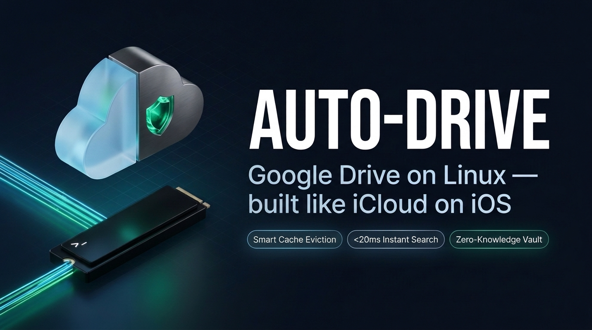

<div align="center">



**Mount your entire Google Drive on the smallest Linux SSD — without filling up local disk.**  
Write at local NVMe speed, auto-evict files after upload, search everything in **`<20ms`**, and lock sensitive data in a zero-knowledge vault with **one password**.

[](LICENSE)
[](#quickstart)
[](#why-auto-drive)
[](installers/)

[**Quickstart**](#quickstart) · [**Layout**](#one-folder-two-worlds) · [**Why AUTO-DRIVE?**](#why-auto-drive) · [**Commands**](#commands) · [**Power Moves**](#power-moves)

</div>

---

## Quickstart

```bash
git clone https://github.com/Bit-Loop/AUTO-DRIVE.git && cd AUTO-DRIVE
./run.sh setup
```

1. **Sign in:** Open the printed Google OAuth link in **any** browser and paste back the redirect URL *(works over plain SSH — no port forwarding or local `rclone` needed)*.
2. **Set one password:** Creates a new encrypted vault—or unlocks your existing one on a second machine.

---

## One Folder, Two Worlds

Everything lives neatly inside `/DRIVE` on Google Drive and auto-mounts at `~/DRIVE` on boot:

```text
~/DRIVE/                          # Auto-mounted at boot (read/write)
├── store/                        # Plain files   — visible in Google Drive Web & mobile apps
├── encrypted/                    # Secret vault  — unreadable ciphertext on Google's servers
│   ├── data/                     #   Datasets, Parquet lakes, SQLite replicas, archives, pcaps
│   └── snapshots/                #   Automated daily 03:30 UTC .tar.zst backups (/etc + $HOME)
├── installers/                   # Setup modules mirrored to your Drive
└── run.sh                        # Unified CLI
```

---

## Why AUTO-DRIVE?

- **iCloud-Style Space Pop** — Writes hit local SSD first, upload in the background, and **evict from local disk ~5 minutes later** while staying visible locally to stream on demand. Cache dynamically caps at **20% of free disk** (`2 GiB` floor) and shrinks automatically as local storage fills up.
- **`<20ms` Instant Search (`drive-find`)** — Keeps your entire directory tree warm in RAM via Google's 20s delta feed (`0` idle API spam) + a local `0600` index with interactive `fzf` search.
- **One-Password Zero-Knowledge Vault** — `600,000`-round `PBKDF2-HMAC-SHA256` deterministically derives both `rclone crypt` keys from a single password. No salt files to lose; zero secrets in Git.
- **Daily Encrypted Snapshots** — Every night at `03:30 UTC`, `/etc` (Nginx, Caddy, TLS certs, systemd) + `$HOME` are archived into `encrypted/snapshots/<host>/` as browseable `.tar.zst` files (`7d / 4w / 6m` retention).
- **Hardened for Lean VPSes** — Auto-creates a 4 GiB swapfile on low-RAM boxes, locks control sockets to `0700` Unix domain sockets (zero localhost TCP ports exposed to SSRF), and configures `~/.ignore` so `rg`/`fd` never accidentally crawl cloud files over the network.

---

## Commands

Run from anywhere via `drive-status` / `drive-find`, or via `./run.sh` (`~/DRIVE/run.sh`):

| Command | Description |
| :--- | :--- |
| `drive-status` | Mount health, dynamic 20% cache usage, upload queue, snapshots & RAM |
| `drive-find [query]` | `<20ms` search across plain + encrypted files *(opens `fzf` if no query)* |
| `./run.sh backup` | Trigger an immediate encrypted `.tar.zst` system snapshot |
| `./run.sh evict` | Immediately pop unlocked cached files from local SSD |
| `./run.sh passwd` | Set or rotate your vault password *(re-encrypts `DRIVE/encrypted`)* |
| `./run.sh reindex` | Force a remote delta check and rebuild the local search index |
| `./run.sh mount` / `unmount` | Start or cleanly stop `~/DRIVE` mounts |

---

## Power Moves

**DuckDB** (`512 MiB` RAM cap + NVMe spill) and **Litestream** come pre-installed and pre-tuned:

```bash
# Query remote Zstd Parquet datasets directly on Google Drive without downloading full files
duckdb -c "SELECT * FROM '~/DRIVE/encrypted/data/recon/*.parquet' LIMIT 20;"

# Stream continuous SQLite WAL backups straight into your encrypted vault
litestream replicate ./app.db ~/DRIVE/encrypted/data/sqlite-backups/app.db
```

<details>
<summary><b>Optional: Bring your own Google Cloud OAuth Client ID</b></summary>

Avoid `rclone`'s shared global API quota pool in two commands (no re-setup required):
```bash
rclone --config ~/.config/auto-drive/rclone.conf config update gdrive client_id YOUR_ID client_secret YOUR_SECRET
./run.sh unmount && ./run.sh mount
```
</details>

---

<div align="center">

**MIT License** · Built for tiny Linux machines with giant storage appetites.  
If **AUTO-DRIVE** saved your SSD, drop a ⭐ on GitHub!

</div>
